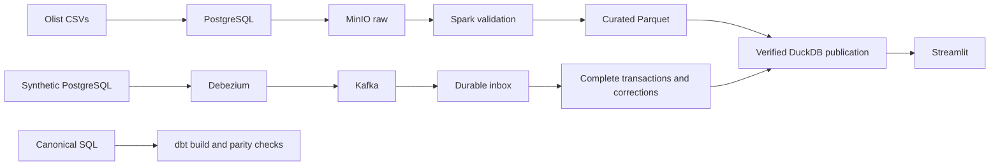

# Olist Trusted Commerce

A local data platform for reconciling e-commerce orders, payments and delivery metrics. The project uses Olist's historical dataset for batch analytics and a separate PostgreSQL simulator to exercise CDC, corrections and recovery.

The main engineering question is simple: when a payment changes, an item is deleted, or a process crashes, can the published numbers still be traced back to the source?

## Data flow



## What is implemented

- Batch ingestion with source checksums, row contracts, quarantine and reconciliation.
- Separate order, item, payment and review grains to prevent join fan-out.
- Immutable publications: readers keep the previous version if a new build fails.
- PostgreSQL WAL capture through Debezium and Kafka, with a durable inbox and transaction completeness checks.
- Updates and deletes with before/after audit, duplicate detection, source ordering and tombstones.
- Independent Decimal checks and full-rebuild parity for all 17 analytical models.
- A seven-tab dashboard covering delivery, sellers, payments, geography, customer cohorts, order traces and data trust.

## Run a small example

Requirements: Docker Desktop with Linux containers, PowerShell, and about 8 GiB available to Docker. The first build downloads dependencies.

```powershell
./scripts/final.ps1 setup
./scripts/final.ps1 demo-fixture
```

This runs the small pipeline and publishes its fixture database. The fixture contains deliberately invalid rows to exercise rejection and reconciliation. The default dashboard reads the historical publication, created in the next step.

For the historical dataset, follow [data setup](docs/DATA_SETUP.md), then run:

```powershell
./scripts/final.ps1 demo-real
```

Open http://localhost:8510 to explore the historical dashboard.

After both baseline publications exist:

```powershell
./scripts/upgrade.ps1 corrections
./scripts/upgrade.ps1 cdc
./scripts/upgrade.ps1 dbt
```

See the [runbook](docs/FINAL_RUNBOOK.md) for restart, recovery and verification commands. To stop the project's services while keeping volumes, run `./scripts/upgrade.ps1 down`.

## Tests and recorded results

```powershell
./scripts/final.ps1 test
./scripts/final.ps1 integration
```

The recorded local validation from October 2026 includes 59 unit tests, 4 integration tests, 17 dbt models and 2 dbt data tests. The historical publication contains 98,059 accepted orders with zero independent per-order financial reconciliation mismatches. These are dated local results; they are not a claim that hosted CI or cloud deployment has run.

- [Design, grains and tradeoffs](docs/FINAL_DESIGN.md)
- [Verification details](docs/FINAL_VERIFICATION.md)
- [Walkthrough and interview discussion](docs/PORTFOLIO_DEMO.md)
- [Canonical analytical SQL](sql/local_marts.sql)

## Limits and tradeoffs

This is a single-host lab. CDC uses synthetic operational data, not a live Olist system. Correction processing refreshes affected order facts, but aggregate marts and the reference comparison still rebuild fully; publication copies the database. CDC consumption runs for a bounded duration. There is no production HA or distributed exactly-once guarantee.

dbt models are generated from the canonical SQL and checked against the serving database. Python and DuckDB own the correction transaction. The Snowflake configuration is optional and has not been deployed as part of the recorded local validation.

## Repository layout

```text
src/olist/    ingestion, contracts, publication, CDC and recovery
sql/         canonical local models
app/         Streamlit dashboard
tests/       unit and integration checks
infra/       container configuration
scripts/     setup, demos and verification
docs/        design and operating notes
evidence/    selected dated validation reports
data/fixtures/  synthetic test inputs
```

## Dataset

Historical data comes from the [Brazilian E-Commerce Public Dataset by Olist](https://www.kaggle.com/datasets/olistbr/brazilian-ecommerce). Download it from the original source and follow its license terms. Historical CSVs, credentials, runtime databases and connector state are excluded from this repository. Included fixtures are synthetic.
