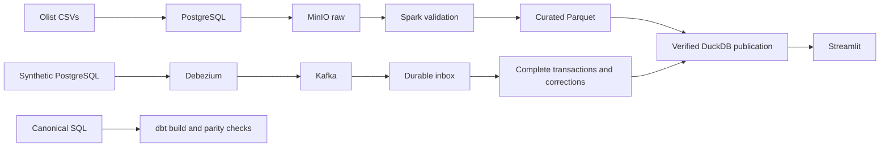

# Olist Trusted Commerce

[](https://github.com/longieoo/olist-trusted-commerce/actions/workflows/ci.yml)

A local data platform for reconciling e-commerce orders, payments and delivery metrics. The project uses Olist's historical dataset for batch analytics and a separate PostgreSQL simulator to exercise CDC, corrections and recovery.

The main engineering question is simple: when a payment changes, an item is deleted, or a process crashes, can the published numbers still be traced back to the source?

## Data flow



## What is implemented

- Batch ingestion with source checksums, row contracts, quarantine and reconciliation.
- Separate order, item, payment and review grains to prevent join fan-out.
- Immutable publications: readers keep the previous version if a new build fails.
- PostgreSQL WAL capture through Debezium and Kafka, with a durable inbox and transaction completeness checks.
- Updates and deletes with before/after audit, duplicate detection, source ordering and tombstones.
- Independent Decimal checks and full-rebuild parity for all 17 analytical models.
- A seven-tab dashboard covering delivery, sellers, payments, geography, customer cohorts, order traces and data trust.

## Run a small example

Requirements: Python 3.10–3.12, Docker with Linux containers and Compose v2+, and about 8 GiB available to Docker. The portable runner uses only Python's standard library. The first build compiles a pinned MinIO source revision and downloads dependencies; allow several minutes and several GiB of disk space.

```sh
python scripts/lab.py demo
```

Open http://localhost:8510. This builds the runtime, creates random local credentials, runs the small pipeline and opens a dashboard with five accepted synthetic orders. Invalid and duplicate fixture rows exercise rejection and reconciliation. No Kaggle account or cloud subscription is needed. When historical data is present, select the clearly labelled fixture source in the sidebar.

For the historical dataset, follow [data setup](docs/DATA_SETUP.md), then run:

```powershell
./scripts/final.ps1 demo-real
```

Open http://localhost:8510 to explore the historical dashboard.

After both baseline publications exist:

```powershell
./scripts/upgrade.ps1 corrections
./scripts/upgrade.ps1 cdc
./scripts/upgrade.ps1 dbt
```

See the [runbook](docs/FINAL_RUNBOOK.md) for restart and recovery. The portable runner uses the isolated Compose project `olist-lab`; `python scripts/lab.py down` stops it while keeping volumes. Legacy PowerShell helpers use `olist-final`, so use one runner consistently.

## Tests and recorded results

```sh
python scripts/check_release.py
python scripts/lab.py verify
```

`verify` exercises the fixture batch, dashboard, unit and storage integration tests, dbt model parity, synthetic WAL CDC, consumer downtime and replay. It writes `evidence/current/ACCEPTANCE.json` and fails if code changes during the run. A failed retry replaces an earlier green status. The same sequence runs on GitHub Actions. Check the badge or Actions page for the actual hosted result.

For a quick check without Docker, install `pip install -c requirements.lock ".[test,local]"`, then run `python -m pytest -q -m "not integration"` with `PYTHONPATH=src` set in your shell.

The recorded local validation from October 2026 includes 59 unit tests, 4 integration tests, 17 dbt models and 2 dbt data tests. The historical publication contains 98,059 accepted orders with zero independent per-order financial reconciliation mismatches. These are dated local results; they are not a claim that hosted CI or cloud deployment has run.

- [Design, grains and tradeoffs](docs/FINAL_DESIGN.md)
- [Verification details](docs/FINAL_VERIFICATION.md)
- [Walkthrough and interview discussion](docs/PORTFOLIO_DEMO.md)
- [Canonical analytical SQL](sql/local_marts.sql)
- [Operating boundaries and failure handling](docs/OPERATIONS.md)

## Limits and tradeoffs

This is a single-host lab. CDC uses synthetic operational data, not a live Olist system. Correction processing refreshes affected order facts, but aggregate marts and the reference comparison still rebuild fully; publication copies the database. CDC consumption runs for a bounded duration. There is no production HA or distributed exactly-once guarantee.

The CDC contract accepts whole-second timestamps; fractional seconds are rejected rather than silently rounded. Dimensions are immutable in the correction engine. Empty, complete CDC baselines are supported.

dbt models are generated from the canonical SQL and checked against the serving database. Python and DuckDB own the correction transaction. The Snowflake configuration is optional and has not been deployed as part of the recorded local validation.

## Repository layout

```text
src/olist/    ingestion, contracts, publication, CDC and recovery
sql/         canonical local models
app/         Streamlit dashboard
tests/       unit and integration checks
infra/       container configuration
scripts/     setup, demos and verification
docs/        design and operating notes
evidence/    selected dated validation reports
data/fixtures/  synthetic test inputs
```

## Dataset

Historical data comes from the [Brazilian E-Commerce Public Dataset by Olist](https://www.kaggle.com/datasets/olistbr/brazilian-ecommerce). Download it from the original source and follow its license terms. Historical CSVs, credentials, runtime databases and connector state are excluded from this repository. Included fixtures are synthetic.

MinIO is built from its [upstream source release](https://github.com/minio/minio/releases/tag/RELEASE.2025-10-15T17-29-55Z) at commit `9e49d5e7a648f00e26f2246f4dc28e6b07f8c84a`, under upstream AGPLv3 terms. This avoids a dependency on withdrawn community image tags. This pinned lab build is not a claim of current production security certification.

## Build a source archive

```sh
python scripts/package_final.py
```

The archive in `dist/` contains tracked public working-tree files and its own SHA-256 manifest. Runtime state, historical CSVs and secrets are excluded even if accidentally tracked. New files must be staged before packaging. Archive checks are independent of pipeline acceptance; each generated ZIP carries a fresh manifest.
